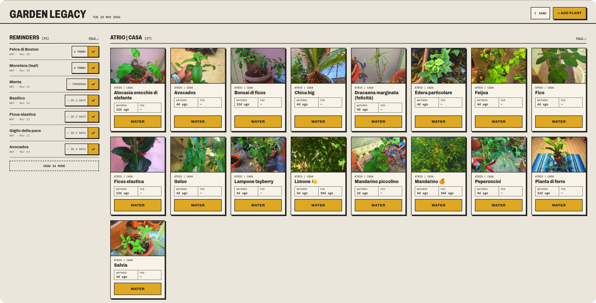

# Garden Legacy

A little notebook for your plants.



Garden Legacy is a small self-hosted web app that remembers the things you'd otherwise forget: which plant got water last Tuesday, when the lemon tree needs feeding, that the basil is due for repotting. Each plant gets a photo, a few notes and its own schedule. It works just as well on a phone in the garden as on a desktop at the kitchen table, and it looks like a field notebook: sharp borders, a bit of yellow, and light and dark themes.

I built it for myself and my household, so it's deliberately simple.

## What it does

- **A dashboard that tells you what to do today.** Plants are grouped by category, and reminders for watering, fertilizing and custom tasks are sorted from overdue to upcoming. Tap ✓ on a reminder to mark it done without opening the plant.
- **Flexible schedules.** Watering, fertilizing and every task can repeat every *N* days, or you can leave the interval empty. Fertilizing and tasks can also be one-offs: choose *On a date* instead of *Repeat* and set a single due date.
- **Custom tasks for each plant.** Pruning, repotting, treating the aphids: name it, give it an interval if you want one, and tick it off when it's done.
- **One photo per plant.** Take it with your phone camera or upload a file. The server turns it into a small, vivid pixel-art picture (a few KB) and keeps it in the database. The original is never stored, so backups stay tiny.
- **Several people, separate gardens.** Every account only sees its own plants and categories.
- **Installable.** On Android, use Chrome's menu → *Install app* for a home-screen icon and a full-screen window. The interface opens from a local copy even when the network is slow. Your data is always fetched fresh from the server.
- **No frontend build.** The UI is plain HTML, CSS and ES modules in `public/`.

## Under the hood

Node.js · TypeScript · [Moleculer](https://moleculer.services) (services plus the `moleculer-web` gateway) · Sequelize · MariaDB · [sharp](https://sharp.pixelplumbing.com) · Docker.

## Try it locally

You'll need Node.js 20 or newer and Docker.

```bash
cd dev-compose && docker compose up -d && cd ..   # MariaDB (3306) + Adminer (http://localhost:8080)
cp .env.example .env                              # defaults match dev-compose
npm install
npm run dev                                       # http://localhost:4005
```

The tables are created on first start. Since there's no sign-up page, add your first user straight in the database (passwords are plain text, see [Things to know](#things-to-know)):

```bash
docker exec garden-db mariadb -usimmaco -psimmacopass garden -e \
  "INSERT INTO users (username,password,isActive,createdAt,updatedAt) VALUES ('demo','demo123',1,NOW(),NOW());"
```

Then open http://localhost:4005 and log in as `demo`.

## Configuration

The app reads a handful of environment variables (see `.env.example`). A `.env` file is loaded at startup, and real environment variables take precedence.

| Variable | Default | What it's for |
|---|---|---|
| `DB_DIALECT`, `DB_HOST`, `DB_PORT`, `DB_DATABASE`, `DB_USER`, `DB_PASSWORD` | – | Database connection, all required. Inside Docker, `DB_HOST` is the name of the DB service, not `localhost`. |
| `WEB_UI_PORT` | `4005` | HTTP port. |
| `TRUST_PROXY` | `false` | How many reverse proxies sit in front of the app (`true` = 1; Cloudflare + Nginx is `2`). Used to find the real client IP for rate limiting and to detect HTTPS. |
| `COOKIE_SECURE` | `auto` | `Secure` flag of the session cookie: `auto` (only on HTTPS), `true` or `false`. |

## Scripts

| Command | What it does |
|---|---|
| `npm run dev` | Run from `src/` with ts-node |
| `npm run typecheck` | Check types only |
| `npm run build` | Compile `src/` into `dist/` |
| `npm start` | Run the compiled app (`dist/index.js`) |
| `npm run icons` | Regenerate the PWA icons in `public/img/` from `favicon.svg` |

## Deploying

Every push to `main` builds an image and publishes it as `ghcr.io/simmacos/garden-legacy` (amd64). The [`deploy/`](deploy/README.md) folder has a production compose file (app + MariaDB) and a step-by-step guide for running it with Dockge behind Nginx Proxy Manager and Cloudflare, including backups and rollbacks.

## Talk to your garden from Claude

The [`mcp/`](mcp/README.md) folder has a small MCP server so Claude Code or Claude Desktop can use the app for you. You can ask what needs water today, say "I just fertilized the ficus", or add a new plant. It logs in like the browser does, so the backend doesn't change. It deliberately can't delete anything. For Claude Desktop there's also a one-click `.mcpb` extension.

## API

Everything is JSON under `/api`, and everything except login needs the session cookie. A resource that belongs to someone else answers `404`.

| Endpoint | Purpose |
|---|---|
| `POST /auth/login` · `GET /me` | Sign in · current user |
| `GET/POST /categories` · `PUT/DELETE /categories/:id` | Categories (deleting one keeps its plants) |
| `GET/POST /plants` · `GET/PUT/DELETE /plants/:id` | Plants |
| `POST /plants/:id/water` · `POST /plants/:id/fertilize` | Record watering or fertilizing (optional `date`, default today) |
| `GET/POST /plants/:id/tasks` · `PUT/DELETE /tasks/:id` · `POST /tasks/:id/done` | Per-plant tasks |
| `GET /photos` · `GET/PUT/DELETE /plants/:id/photo` | Photos; `PUT` takes the raw image file as the body (max 12 MB) |
| `GET /reminders` | Overdue and upcoming reminders, sorted by due date |
| `GET /dashboard` | Plants, reminders and photo list in a single response |

**One-off dates:** a plant has `fertilizingDueDate` and a task has `dueDate` (`YYYY-MM-DD` or `null`). When set, that date *is* the reminder and wins over "last time + interval". Marking the item done (`/fertilize`, `/tasks/:id/done`) clears the date and sets the last date to today. For a task the interval is cleared too, so it doesn't come back.

## Where things live

```
src/
  index.ts            entry point (Moleculer broker)
  models/             Sequelize models
  lib/                dates, validation, reminders, photo processing, rate limiting, client info, schema upgrades
  services/           gateway, auth, reminders, dashboard
  services/data/      DB-backed services: users, sessions, categories, plants, tasks, photos
public/               static frontend (HTML, CSS, ES modules)
mcp/                  MCP server for Claude
deploy/               production compose file + home-server guide
dev-compose/          MariaDB + Adminer for development
Dockerfile            multi-stage image, runs as non-root
.github/workflows/    builds and publishes the image to GHCR
```

## Things to know

This is an internal-use app, and some choices reflect that:

- **Sessions** last 30 days and renew themselves while you use the app (at most once a day). They end after 30 days of inactivity, or 180 days after login.
- **Login is rate-limited**: 5 failures per IP+user and 20 per IP in 15 minutes. The counters live in memory, so a restart resets them.

## License

[ISC](LICENSE)
